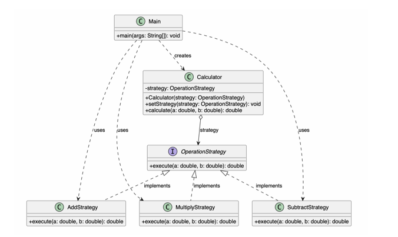

# Assignment #5 — Strategy Design Pattern

**Student:** Balnur Oraztay  
**Group:** SE-2524  
**Option:** B — Calculator  
**Language:** Java (JDK 17)

## 1. Introduction

In this assignment, I implemented the Strategy Design Pattern using a simple calculator application in Java.

The chosen domain is mathematical calculations. The algorithm family consists of three operations: addition, subtraction, and multiplication.

Each operation is implemented in a separate strategy class. The Strategy Pattern allows the calculator to switch between these operations at runtime without changing the Calculator class.

## 2. UML Class Diagram



The UML diagram includes the following components:

- **Strategy Interface:** `OperationStrategy`
- **Concrete Strategies:** `AddStrategy`, `SubtractStrategy`, `MultiplyStrategy`
- **Context:** `Calculator`
- **Client:** `Main`

The Calculator class uses the OperationStrategy interface to perform calculations.

The Main class selects and changes strategies using the `setStrategy()` method.

## 3. Clean Code Principles

### 3.1 Single Responsibility Principle (SRP)

Each strategy class has only one responsibility. For example, AddStrategy performs addition, while SubtractStrategy performs subtraction. This makes the code easier to understand and maintain.

**Code Example:**

```java
public double execute(double a, double b) {
    return a + b;
}
```

**Explanation:** The method performs only addition and does not contain any other calculation logic.

### 3.2 Meaningful Names

The project uses meaningful class and method names such as `AddStrategy`, `SubtractStrategy`, `MultiplyStrategy`, `calculate()`, and `setStrategy()`.

**Code Example:**

```java
public class AddStrategy implements OperationStrategy {
    @Override
    public double execute(double a, double b) {
        return a + b;
    }
}
```

**Explanation:** The name AddStrategy clearly describes the mathematical operation performed by the class.

### 3.3 Elimination of Conditional Logic

The Strategy Pattern replaces conditional logic with polymorphism. Instead of using if/else or switch statements to select an operation inside the calculator, the program delegates the calculation to the selected strategy.

**Code Example:**

```java
public double calculate(double a, double b) {
    return strategy.execute(a, b);
}
```

**Explanation:** The `calculate()` method does not check which operation is selected. It calls the strategy through the common interface.

### 3.4 Context Remains Algorithm-Agnostic

The Calculator class does not know how addition, subtraction, or multiplication is implemented. It only depends on the OperationStrategy interface.

**Code Example:**

```java
private OperationStrategy strategy;

public Calculator(OperationStrategy strategy) {
    this.strategy = strategy;
}
```

**Explanation:** The Context works with the interface instead of depending on specific strategy classes.

### 3.5 Open/Closed Principle (OCP)

The program can be extended by adding new strategies without modifying the existing Calculator class.

**Code Example:**

```java
public interface OperationStrategy {
    double execute(double a, double b);
}
```

**Explanation:** A new operation can be implemented by creating another class that implements OperationStrategy. The existing Context does not need to be changed.

## 4. Strategy vs. State

Strategy and State are both behavioral design patterns, but they solve different problems.

The Strategy Pattern allows the client to choose between different algorithms, while the State Pattern changes an object's behavior depending on its internal state.

In my calculator project, the user of the Calculator class selects mathematical operations by changing strategies.

Therefore, Strategy is more appropriate than State because the program switches between independent algorithms rather than managing state transitions.

## 5. Conclusion

In this assignment, I learned how to implement the Strategy Design Pattern using interfaces, composition, and polymorphism.

The main advantage is flexibility because mathematical operations can be changed at runtime and new strategies can be added without modifying the calculator logic.

The disadvantage is that the pattern requires additional classes and an interface. However, this structure makes the code more organized, reusable, and easier to maintain.

## 6. GitHub Repository

**Repository Link:** https://github.com/balnuroraztai/Strategy-Calculator.git
